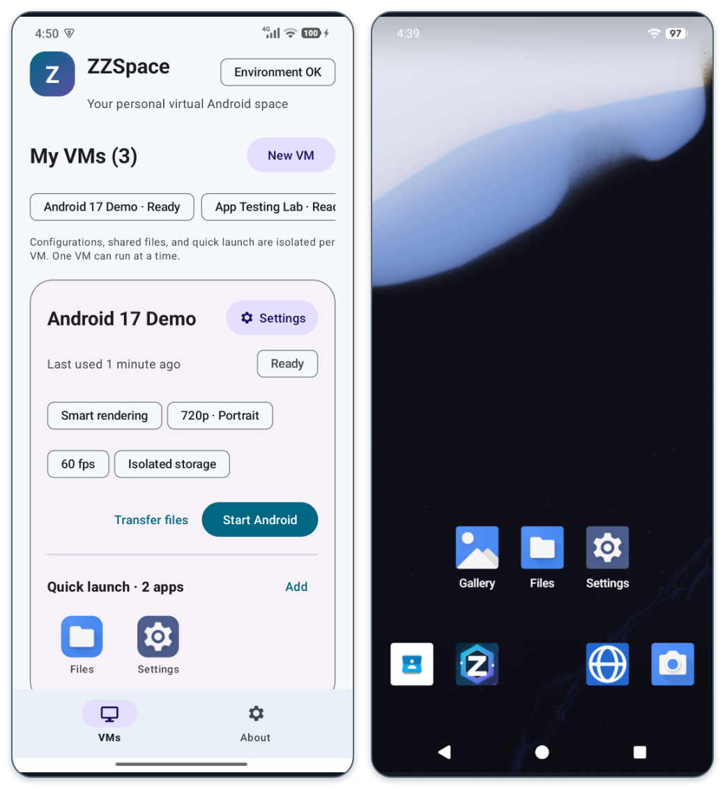

  
  

<h1 align="center">Run Android 17 on your Android device</h1>

  ZZSpace is a lightweight Android virtual machine that installs like any other app. No root or flashing required. 
  Run apps in a separate space, use app clones for different accounts, and share files with your device.

## ZZSpace in action

Choose a space and tap **Start Android** to open its Android 17 home screen.

  

## More ways to use one Android device

### Advanced features at a glance

Adjust the display for each space, copy a VM you’ve already set up, or create several instances of an app.

<table>
  <thead>
    <tr><th width="142" align="left">Advanced feature</th><th align="left">What you can do</th></tr>
  </thead>
  <tbody>
    <tr><td><strong>Create a VM</strong></td><td>Create an Android 17 space for a particular task, with its own home screen, apps, and settings.</td></tr>
    <tr><td><strong>Display resolution</strong></td><td>Choose <strong>480p, 540p, 720p, or 1080p</strong>, or set the width, height, and display density yourself.</td></tr>
    <tr><td><strong>Screen orientation</strong></td><td>Set each space to portrait or landscape to suit the apps you use in it.</td></tr>
    <tr><td><strong>Frame rate</strong></td><td>Select a target of <strong>30, 60, 90, or 120 fps</strong>. Available rates depend on the device display and rendering mode.</td></tr>
    <tr><td><strong>Graphics rendering</strong></td><td>CPU rendering is available on supported devices. Android 11 or later also supports GPU rendering. Smart rendering tries the GPU first and falls back to the CPU if GPU startup fails.</td></tr>
    <tr><td><strong>Clone a VM</strong></td><td>Copy a space with its installed apps, app data, and system settings. The new VM starts with an empty shared folder.</td></tr>
    <tr><td><strong>App clones</strong></td><td>Create up to <strong>100 clones per supported app</strong>. Each clone keeps its own sign-in and app data.</td></tr>
    <tr><td><strong>App installation and import</strong></td><td>Install an APK inside the space or import a compatible app already on your device. APKs with native libraries must support ARM64.</td></tr>
  </tbody>
</table>

### Use your device’s features inside the VM

| Device feature | What you can do |
| --- | --- |
| **Camera** | Use the front or rear camera to take photos, record video, or scan a code inside the space. |
| **Microphone** | Use the device microphone to record a voice note or dictate text in an app. |
| **Audio playback** | Play music and hear sound from videos and other apps through your device. |
| **Location** | Let maps and other apps use the device’s approximate or precise location, depending on the permission you grant. |
| **Sensors** | Apps can sense motion, rotation, magnetic fields, ambient light, pressure, and proximity using the hardware available on the device. |
| **Clipboard** | Copy text or links on the device and paste them inside a space, or copy them back. |

Each space has its own switches for camera, microphone, location, sensors, and clipboard sharing. ZZSpace requests permission when you enable the camera, microphone, or location. Camera and microphone access requires an unlocked device with the VM visible.

### Separate spaces, independent data

Keep work and personal apps in separate spaces, each with its own data.

### Transfer files between your device and a VM

Bring photos, documents, or a whole folder into a space, or save files from the space back to your device.

### Open a favorite app with one tap

Pin an app or one of its clones to the ZZSpace home screen. The next time you need it, tap its shortcut to open it.

### Android 17 is built in

Android 17 comes with ZZSpace. Follow the initial setup guide, then start a space to load the system from your device and open its desktop.

## Get started in three steps

1. Install ZZSpace on your Android device.
2. Open ZZSpace and follow the [first-time setup guide](#first-time-setup).
3. Create a VM and tap **Start Android** to open its desktop.

## Q&A

### 1. How do I set up ZZSpace for the first time?

> [!CAUTION]
> **Required before you start**
>
> These steps apply to devices running Android 12 or later.
>
> 1. In your device settings, find **Build number** and tap it seven times to enable **Developer options**.
> 2. In **Developer options**, turn on **Disable child process restrictions**. [Help finding this switch](#child-process-setup)
> 3. Return to ZZSpace, check the environment status on the **VMs** tab, and follow any remaining prompts.

The location of **Build number** depends on the device. [Android’s Developer options guide](https://developer.android.com/studio/debug/dev-options)

### 2. What if “Disable child process restrictions” is missing?

Some devices omit or rename this switch. Open the child process item in ZZSpace’s environment check for setup instructions and online help. ZZSpace checks the setting again when you return to the app.

### 3. Which apps can I install?

The space runs apps compatible with Android 17. In **ZZSpace Helper**, choose **Install APK file** or **Import installed apps**.

### 4. Why might I need to sign in again after cloning a space?

A cloned space keeps the original apps, data, and settings and has its own device identity. Apps that tie your session to a specific device may ask you to sign in again. If an app keeps having trouble, try installing it in a fresh space.

### 5. How many app clones can I create?

Each supported app can have up to **100 clones**, each with its own data. Idle clones may go to sleep, which can delay notifications. Open a clone to resume it.

### 6. What if a space won’t start or stops in the background?

Run the environment check and follow any prompts, then check that Android allows ZZSpace to run in the background. If the problem persists, open **Settings → Diagnostics &amp; repair** on the VM card to export diagnostics.

## Contact

  Email: <code>corespaceteam@gmail.com</code> 
  WeChat ID: <code>corespaceteam</code>

