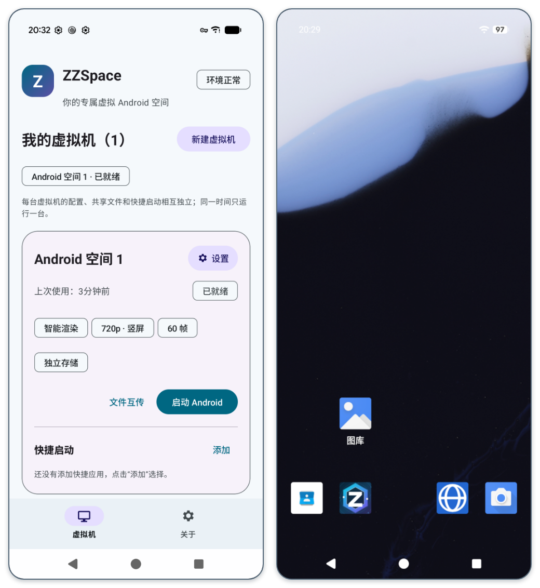

  
  

<h1 align="center">在 Android 设备上运行 Android 17</h1>

  ZZSpace 是一款轻量级的 Android 虚拟机，可像普通应用一样安装，无需 Root 或刷机。 
  在独立空间里运行应用，用分身登录不同账号，还能与本机互传文件。

## ZZSpace 实机体验

选好空间，点「启动 Android」，就能进入这个空间的 Android 17 桌面。

  

## 一台设备，多种用法

### 高级功能一览

每个空间都能单独设置显示效果。你也可以克隆已经配置好的虚拟机，或为同一个应用创建多个分身。

<table>
  <thead>
    <tr><th width="142" align="left">高级功能</th><th align="left">可以做什么</th></tr>
  </thead>
  <tbody>
    <tr><td><strong>新建虚拟机</strong></td><td>按用途创建独立的 Android 17 空间，每个空间都有自己的桌面、应用和设置。</td></tr>
    <tr><td><strong>分辨率设置</strong></td><td>可选 <strong>480p、540p、720p 或 1080p</strong>，也可自定义画面宽高和显示密度。</td></tr>
    <tr><td><strong>屏幕方向</strong></td><td>每个空间可分别设为横屏或竖屏，方便使用不同布局的应用。</td></tr>
    <tr><td><strong>帧率设置</strong></td><td>提供 <strong>30、60、90 和 120 帧</strong>档位，可选范围取决于设备屏幕和渲染模式。</td></tr>
    <tr><td><strong>图形渲染</strong></td><td>支持 CPU 软件渲染，Android 11 及以上设备也可使用 GPU 硬件渲染。智能模式优先尝试 GPU，启动失败时自动回退到 CPU。</td></tr>
    <tr><td><strong>克隆虚拟机</strong></td><td>复制已有空间的应用、应用数据和系统设置，省去重新安装和配置。副本的共享文件夹初始为空。</td></tr>
    <tr><td><strong>应用分身</strong></td><td>每个支持的应用最多可创建 <strong>100 个分身</strong>，各自保存登录状态和应用数据。</td></tr>
    <tr><td><strong>应用安装与导入</strong></td><td>可以在空间里直接安装 APK，也可以导入本机已安装的兼容应用。含原生库的安装包需支持 ARM64。</td></tr>
  </tbody>
</table>

### 设备能力，在虚拟机里也能用

| 设备能力 | 可以做什么 |
| --- | --- |
| **相机** | 在空间里调用设备的前、后置摄像头拍照、录像或扫码。 |
| **麦克风** | 使用本机麦克风录制语音，或在应用中进行语音输入。 |
| **音频播放** | 空间里的音乐、视频中的声音和应用提示音，都能通过本机播放。 |
| **定位** | 地图等应用可使用本机提供的大致或精确位置，精度取决于授予的权限。 |
| **传感器** | 可使用设备配备的加速度计、陀螺仪、磁力计，以及光照、气压和距离传感器。 |
| **剪贴板** | 在本机与空间之间双向复制、粘贴文字和链接。 |

每个空间可单独开关相机、麦克风、定位、传感器和剪贴板共享。启用相机、麦克风或定位时，ZZSpace 会按需申请设备权限。授权后，相机和麦克风仅在设备解锁且虚拟机界面可见时可用。

### 多个空间，各自保存

工作和生活可以各用一个空间，应用和数据分开保存。

### 本机与虚拟机之间的文件互传

把本机的照片、文档或整个文件夹传进空间，也可以把空间里的文件保存回本机。

### 快捷启动，一点直达

将空间里常用的应用或分身添加到 ZZSpace 首页，下次轻点快捷方式就能打开。

### 系统内置，跟着引导开始

Android 17 系统随 ZZSpace 一起安装。按引导完成首次设置，启动空间时就会从本机加载系统，进入独立桌面。

## 三步开始使用

1. 在 Android 设备上安装 ZZSpace。
2. 打开 ZZSpace，按[首次使用说明](#first-time-setup)完成设置。
3. 新建虚拟机，点「启动 Android」进入桌面。

## QA · 常见问题

### 1. 首次使用，要怎么设置？

> [!CAUTION]
> **使用前必须完成**
>
> 以下设置适用于 Android 12 及以上设备。
>
> 1. 在设备的系统设置中找到版本号，通常连续点七次即可开启**开发者选项**。
> 2. 在「开发者选项」中开启**停止限制子进程**。[找不到开关时的说明](#child-process-setup)
> 3. 返回 ZZSpace，查看首页的环境检测结果，按提示完成剩余设置。

系统设置的入口可能因设备而异。[Android 开发者选项说明](https://developer.android.com/studio/debug/dev-options?hl=zh-cn)

### 2. 找不到「停止限制子进程」怎么办？

部分设备没有这个开关，或使用了其他名称。在 ZZSpace 的「环境检测」中打开子进程检测项，可查看设置指引和在线帮助。返回应用后，ZZSpace 会自动重新检测。

### 3. 可以安装哪些应用？

空间可以运行兼容 Android 17 的应用。打开「ZZSpace 助手」，选择「安装 APK 文件」或「导入已安装的应用」。

### 4. 克隆虚拟机后，为什么有些应用需要重新登录？

新空间会保留原空间的应用、数据和设置，并使用独立的设备标识。绑定设备的应用可能要求重新登录。如果应用反复出现异常，可以新建虚拟机后重新安装。

### 5. 应用分身可以创建多少个？

每个支持的应用最多可创建 **100 个分身**，各自保存数据。闲置分身可能会休眠，期间通知可能延迟。再次打开分身即可恢复运行。

### 6. 启动失败，或者切到后台后停止了怎么办？

先打开「环境检测」，处理提示的项目，再检查系统是否允许 ZZSpace 在后台运行。问题持续时，可从虚拟机卡片的「设置 → 诊断与修复」导出诊断信息。

## 联系方式

  邮箱：<code>corespaceteam@gmail.com</code> 
  微信号：<code>corespaceteam</code>

